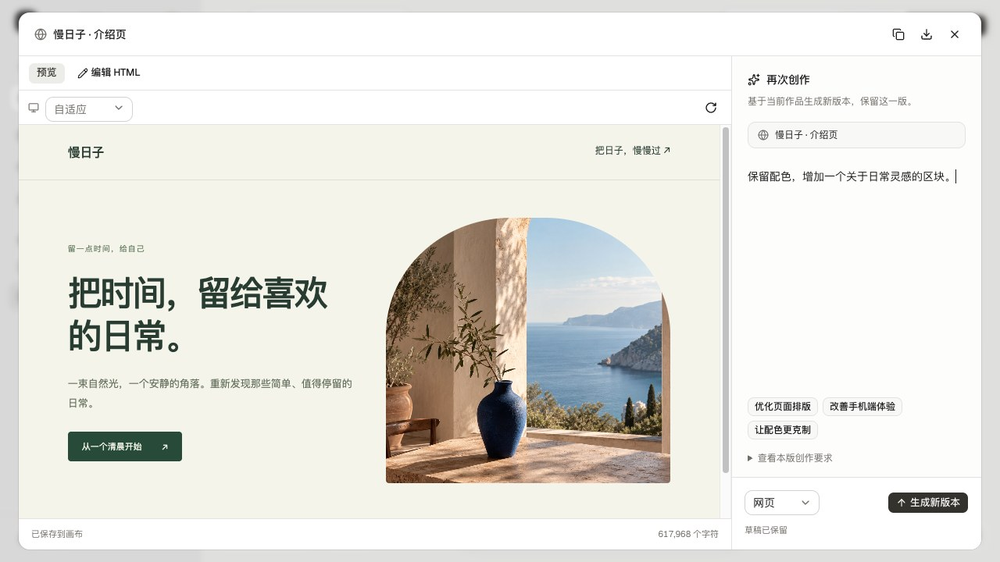

# Huayu 画语

简体中文 · [English](./README.en.md)

画语是一个本地运行的 AI 创作画布。把文字、图片、草图和录屏放在一起，连接材料、生成作品，再沿着结果继续修改和创作。

[快速开始](./docs/GETTING_STARTED.md) · [白板与作品](./docs/USER_GUIDE.md) · [模型连接](./docs/MODEL_SETUP.md) · [录屏与分析](./docs/RECORDING_GUIDE.md) · [常见问题](./docs/TROUBLESHOOTING.md)



当前为 `0.1.0` 本地发布候选。功能验收、来源授权和正式公开前的剩余工作见 [发布清单](./docs/RELEASE.md)；已完成的本地检查见 [验证记录](./docs/VERIFICATION.md)。

项目融合 MenteX 的 React 画布与 tpk-admin 的 MenteX 业务模块，使用 Rust、Axum 和 Tokio 提供本地数据接口。白板基于 Excalidraw，图表使用 React Flow，界面使用 shadcn/ui 的 Base UI 组件，支持浅色、深色和跟随系统。配色约定见 [THEME.md](./docs/THEME.md)。

无需注册、登录、会员或积分。模型服务地址、API 密钥、模型名称、音色与搜索配置仅保存在当前浏览器。

## 本地启动

先按 [Vite+ 安装指南](https://viteplus.dev/guide/) 安装 `vp`。项目使用 Vite+ 1.5.0，需要 Node.js 22.18 或更高的 22.x 版本、24.11 或更高的 24.x 版本，或 Node.js 26 及以上版本；同时需要 Rust 1.95 或更高版本。`vp install` 会使用项目锁定的 pnpm 12.11.2 安装依赖。建议在 PATH 中安装 FFmpeg 与 ffprobe，以分段读取长录屏音轨；未安装时可回退到浏览器音频解码。FFmpeg 是外部可选工具，不随本仓库分发。

```sh
vp install --frozen-lockfile
vp run dev
```

打开 <http://127.0.0.1:5173>。本地 API 默认监听 `127.0.0.1:5858`。首次启动会自动创建 SQLite 数据库，不需要 MySQL、Redis、PHP、Node 后端或云存储账户。

在侧栏底部打开「设置 → 模型连接」，为需要的能力填写服务地址和模型名称。支持 OpenAI 兼容的文本、图像理解、图片生成与编辑、语音合成和语音识别接口；可连接支持浏览器访问的本机模型服务。联网搜索支持 Tavily 和 Brave Search。浅色、深色和跟随系统可在「设置 → 通用」中切换。

按 `⌘ K`（Windows / Linux 为 `Ctrl K`）可查找项目、录屏，或直接新建项目、打开模型设置。手机与收起侧栏时可使用顶部搜索按钮。首页的「继续上次创作」会记住当前浏览器最后打开的画布。

模型设置中的修改和清除均在点击「保存设置」后生效，取消会保留原连接。多个能力可以复用文本生成的服务地址与密钥，各自的模型名称、音色和识别格式分别保留。切换能力或修改字段会取消旧的连接测试。

模型服务需要允许页面来源的浏览器跨域请求。连接地址填写 API 根地址，例如 `http://localhost:11434/v1`。各模型支持的图片尺寸、音色和识别格式由模型服务决定。没有密钥的本机服务可以留空 API 密钥。

## 数据存储与模型请求

| 内容 | 存储位置 |
| --- | --- |
| 模型连接与密钥 | 当前浏览器的 `localStorage`，键为 `huayu:model-settings:v1` |
| 主题选择 | 当前浏览器的 `localStorage` |
| 最后打开的项目标识 | 当前浏览器的 `localStorage` |
| 录屏回看位置与倍速 | 当前浏览器的 `localStorage`，按录屏区分 |
| 创作要求、输出类型、素材选区与作品编辑草稿 | 当前浏览器的 `localStorage`，按项目和作品区分 |
| 尚未提交成功的画布修改、视图状态 | 当前浏览器的 IndexedDB |
| 项目、模板、录屏及分析结果 | `var/dev/huayu.sqlite3` |
| 上传文件、生成附件和录屏 | `var/dev/assets/` |

后端没有模型配置、登录、会员、支付或积分接口，也不代理模型请求。浏览器直接向所配置的模型服务发送生成请求；连接配置不会写入数据库、画布、模板或项目导出文件。使用远程模型时，所选的输入内容会发给该模型服务。需要内容也不离开本机时，应配置本机模型服务。

清除浏览器站点数据会删除该浏览器中的模型设置和尚未提交的修改。SQLite 及附件目录中的已保存数据会保留。不同端口属于不同浏览器来源：开发地址 `5173` 与构建后地址 `5858` 的模型设置相互独立。

默认服务仅监听本机。本机管理端可以管理工作区；协作链接只授予指定画布的编辑权限，使用独立界面，不显示项目列表、全局素材库和录屏管理。关闭协作使旧链接失效，重新开启生成新链接。需要局域网访问时，显式配置本机的具体局域网地址并控制访问范围。

每个房间默认支持 15 位协作者（房主不占名额），顶部头像组可查看在线成员，房主可以确认移出成员。

协作步骤见 [多人协作](./docs/USER_GUIDE.md#多人协作)，跨设备配置见 [局域网协作](./docs/DEPLOYMENT.md#局域网协作)。

## 主要功能

- Excalidraw 单一无限白板：压感绘图、文字、图片、图形、画框、箭头绑定、分组、撤销重做、缩放和本地素材库。组件可从左侧点击添加或拖入画布，卡片内也支持 Ctrl＋滚轮缩放。
- 指令、文本、图片、语音、网页、文件、图表、运行、外部链接和 AI 解答组件。
- 连线传递多模态内容；运行节点按依赖顺序执行；分支汇合后运行一次；支持锁定、停止与循环检测；可运行单个节点或整张白板，并查看节点状态。
- 通过组件连线组织素材和创作步骤；图片、语音、文件、网站和图表工具常驻组件内部，沿用旧版的位置与操作方式。
- 文字、图片与网页的作品窗口：Markdown 阅读与正文编辑、图片缩放与裁剪旋转、网页交互预览与 HTML 编辑；支持复制与下载；图片裁剪保留原图，已有版本可继续查看。
- 文字编辑草稿在关闭或刷新后恢复；失败和停止后可重新运行节点，关闭作品窗口后生成仍会继续；复制实际图片，下载 Markdown、图片与 HTML。
- 图文生成、图片参考编辑、语音合成与识别、网页预览、文件上传解析与生成、可编辑的思维导图和流程图。
- 项目与录屏快速查找、键盘导航、重命名、复制、删除；内置示例、示例标签、保存为示例和从示例创建项目。首次打开画布会生成首页预览，复制未打开过的示例也保留初始工作流。
- 本地自动保存、IndexedDB 断线恢复、同一实例的 WebSocket 实时同步与协作链接。
- 导出 PNG、SVG、包含附件的 `.huayu.json` 项目；导入本项目文件、原生 `.excalidraw` 及兼容的 tldraw JSON 文件。原生 Excalidraw 文件包含整个画布与图片，AI 卡片保留可见快照和可恢复的内容。
- 屏幕、标签页、窗口和音频录制，暂停、继续、结束后预览、下载和保存；关闭保存窗口后仍可继续保存，放弃录屏需要明确确认。保存与导入后可直接回看。
- 可仅转写语音，再整理内容；回看位置与倍速自动恢复；转写跟随只滚动句子列表。手机可切换回看与内容整理，点击章节返回对应片段。
- 录屏转写、完整内容记录、章节速览、问答回顾；搜索、点击定位、跟随播放、校对转写、上一句/下一句与倍速播放；导出 TXT、SRT、VTT 和 Markdown。
- 将录屏内容、章节、单句或多选转写转为可编辑的创作画布；每份选段保留独立的来源与时间位置。新画布自动展开素材，可阅读、修改、继续创作或返回原片段核对。

文档解析支持 UTF-8 文本、Markdown、CSV/TSV、JSON、YAML、XML、HTML、CSS、JavaScript、PDF、DOCX 和工作簿（XLSX/XLS/ODS）。文件组件提供常用格式选择；解析文档最大 10 MB。附件及录屏最大 512 MB。扫描 PDF 需要先进行 OCR。

录屏优先使用本地 FFmpeg 按五分钟读取 16 kHz 单声道音轨，浏览器直接发送至已配置的识别服务；服务端不连接模型。未安装本地解码器时，回退到浏览器解码。时间戳与发言人来自识别服务；选择「仅文字」时，只能保留所在分段的时间范围，无法定位逐句原声。每段识别及每批内容整理完成后立即保存。任务可在应用内切换页面时继续；刷新、取消或失败后，点击「继续分析」复用已完成部分。重新识别会清空对应的处理中间结果，旧报告在新报告完成前仍可阅读。

## 语言

应用与官网支持简体中文和 English。首次访问按浏览器首选语言匹配，其他语言回退英文；可在「设置 → 通用 → 语言」手动切换并记住偏好，选择「跟随浏览器」恢复自动检测。已有项目、提示词和作品不会随界面语言自动翻译。不同来源与端口的浏览器偏好独立保存。

## 构建与运行

```sh
vp run build
vp run start
```

打开 <http://127.0.0.1:5858>。Rust 服务同时提供前端构建文件和本地 API。

可选配置见 [.env.example](./.env.example)。复制为 `.env` 后调整本地路径或端口。不要在环境文件中设置 AI 密钥；模型连接由浏览器界面管理。

```sh
cp .env.example .env
```

`HUAYU_DATA_DIR` 默认是 `var/dev`，`HUAYU_WEB_DIR` 默认是 `apps/web/dist`。备份时同时保留数据库和整个附件目录；数据库正在运行时请使用 SQLite backup API，或先停止服务再复制数据库及其 WAL 文件。删除录屏或项目记录不会自动回收可能被其他画布复用的附件。

已安装在独立目录的 Rust 工具链可通过 `.env` 中的 `HUAYU_RUST_TOOLCHAIN_DIR` 指定，该目录应包含 `.cargo/` 和 `.rustup/`。通常不需要设置。

## 开发与验证

构建分包、字体资源与体积预算见 [构建体积说明](./docs/BUILD_PERFORMANCE.md)。

前端开发、构建、测试和静态检查由 Vite+ 统一驱动，配置位于根目录及各应用的 `vite.config.ts`。`vp run dev` 同时启动 Web 与 Rust API；`vp run check` 和 `vp run test` 包含 Rust 检查与测试。`vp check` 和 `vp test` 可单独检查前端。未全局安装 `vp` 时，可先运行 `pnpm install --frozen-lockfile`，再用 `pnpm exec vp run <任务名>` 执行项目任务。

```sh
vp run check
vp run test
vp run lint:rust
```

Rust 接口和数据测试使用独立临时目录。`vp run test` 不会清空开发数据库。逐项迁移对照见 [功能对照](./docs/FEATURE_PARITY.md)，代码结构和迁移范围见 [架构说明](./docs/ARCHITECTURE.md)，接口见 [API 说明](./docs/API.md)，已执行的验证见 [验证记录](./docs/VERIFICATION.md)。

参考 tldraw computer 的设计研究、已实现的创作链路及后续产品优先级，见 [产品设计](./docs/PRODUCT_DESIGN.md)。

## 介绍页、文档与源码包

`apps/site` 是独立的 React 静态介绍页，包含产品界面、使用指南、文档搜索、代码复制与深浅色模式。内容直接复用本仓库 Markdown，构建时预渲染首页与全部文档；不需要应用数据库，也不连接模型。

```sh
vp run dev:site
vp run build:site
vp run preview:site
```

开发与预览地址为 `http://127.0.0.1:5863`。静态部署及真实仓库地址的配置见 [部署与备份](./docs/DEPLOYMENT.md)。

```sh
vp run check:security
vp run check:release
vp run licenses:check
vp run package:source
```

安全检查与源码打包独立执行。源码包通过 `git archive` 生成，默认归档已提交的 `HEAD`，也可用 `vp run package:source <tag-or-commit>` 指定版本；不会包含未提交或未跟踪的改动。归档使用目标提交中的 `.gitattributes` 排除运行数据、环境文件和缓存，压缩包与 SHA-256 校验文件输出到 `var/releases/`。正式发布前，在目标提交的干净检出目录运行检查。贡献方式见 [CONTRIBUTING.md](./CONTRIBUTING.md)，安全边界与问题报告见 [SECURITY.md](./SECURITY.md)。

## 来源与许可

本地整合基于以下仓库版本，未修改原仓库工作区：

- [MenteX](https://codeup.aliyun.com/65b0683c6cfbead1a8f73587/MenteX)，`8d9da964571dd26ea80056936ea8829804be07cf`。
- [tpk-admin](https://codeup.aliyun.com/65b0683c6cfbead1a8f73587/edu/tpk-admin)，`2d2c1bd8397712b81933b9380f9178a72d70af58`。

本项目有权许可的自有应用代码和画布层选用 [MIT](./LICENSE)，允许免费商用、修改和再分发；分发副本或实质部分时须保留版权与完整许可声明。选择依据、贡献许可和来源授权范围见 [开源许可](./docs/LICENSING.md)。其中，tpk-admin 的 Laravel 模板许可声明不足以单独确认自有业务代码与提示词的公开再分发授权，正式公开这些来源内容前需要相应权利依据。

白板交互使用 Excalidraw 0.18.1（MIT），图表使用 React Flow 12.12.0（MIT），允许免费商用，不需要许可证密钥或订阅。本项目不再依赖 tldraw，也不打包其 SDK、图标、字体或许可校验代码。历史 tldraw JSON 仅作为兼容输入格式读取。第三方代码、Rust 依赖、字体及素材保留各自许可，见 [第三方许可说明](./THIRD_PARTY_NOTICES.md) 和 [前端依赖许可清单](./docs/DEPENDENCY_LICENSES.md)。
