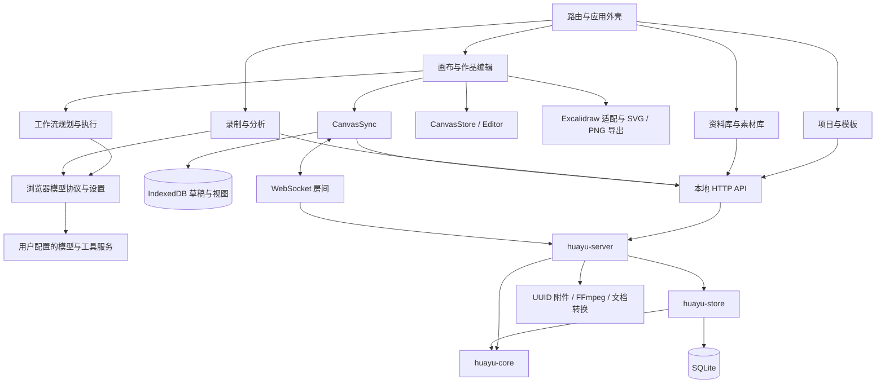

# 工程架构与状态所有权

本图面向修改代码的维护者。六个页面入口由 `apps/web/src/main.tsx` 组合。后端是一个本地服务进程和一份 SQLite 数据库。浏览器同时与本地服务和用户选定的模型服务通信，两条请求路径分别管理凭据。构建时的模板 JSON 与 SVG、运行时的数据库和浏览器独占设置分别在下表标明。



图中箭头表示调用或数据流。要查看源码级的导入边，可从仓库根目录运行以下命令。DOT 文件展示 Web `src` 内 TS/TSX 文件之间的边，包括测试、类型引用、转发导出和字面量动态导入。JSON 模板、CSS、静态资源、第三方包、构建脚本和运行时计算的路径在模块图之外。静态值导入循环由 Oxlint 独立检查。文件边与目录之间的双向使用需要分别判断，例如录制功能可创建画布，画布也可启动录制。

```sh
mkdir -p var/dev
node scripts/check-web-dependencies.ts --dot > var/dev/web-modules.dot
sh scripts/cargo.sh tree --workspace --depth 1
```

## 构建与资源依赖

| 输入 | 消费者 | 产物或检查 |
| --- | --- | --- |
| `package.json` 与锁文件 | Vite+、pnpm、CI | Web 依赖、测试、类型检查、生产包预算 |
| `Cargo.toml` 与 `Cargo.lock` | Cargo workspace、`scripts/cargo.sh` | core、store、server 及服务端测试二进制 |
| `templates/catalog.json`、原始插图 | `generate-template-index.ts`、模板播种、画布配方 | 项目页只读轻量索引，进入画布后加载完整素材 |
| `templates/quick-start.json` 与配方 | 模板播种、项目页、封面生成器 | 四套快速开始模板，按语言生成封面 |
| 锁定的字体、导出 worker、CSS、许可文件 | `apps/web/vite.config.ts` 与 `apps/web/build/` | 本地静态资源、压缩版本和分包限制 |
| 文档解析依赖与系统 FFmpeg | 服务端文档和媒体适配器 | 附件转换与音轨分段，浏览器管理后续模型请求 |
| Git 提交树、项目文件清单 | `package-source.ts`、`check-release.ts`、`check-security.ts` | 源码归档、链接和文件检查 |

Node 工具随环境通过 TypeScript 直接运行；封面生成脚本需使用前端的路径解析和 SSR 构建。生产构建继续验证索引的一致性。Rust 的直接 crate 依赖可从三个 `Cargo.toml` 验证；Cargo 在构建时拒绝 crate 依赖环。`scripts/check-rust-dependencies.ts` 检查 Cargo 解析的常规直接依赖，阻止 core 引入 SeaORM 或 Axum、store 引入 Axum；测试依赖仍可使用。

## 修改入口

下表路径相对于 `apps/web/src/`；Rust 路径相对于 `apps/api-rust/crates/`。具体状态转换、迟到结果和取消处理见[状态生命周期清单](../STATE_MACHINES.md)。接口请求及返回字段见[本地 API 契约](../API.md)。

| 概念 | 权威实现与公开入口 | 状态的去向与可独立修改的部分 |
| --- | --- | --- |
| 路由、设置与搜索弹层 | `main.tsx`、`components/WorkspaceLayout.tsx`、`components/Shell.tsx` | 路由持有页面身份，Shell 持有覆盖层。跨路由录制由 RecorderProvider 持有。功能代码可在各自目录内演进。 |
| UI 外观与文字 | `main.css` 语义色、`components/ui/` 控件、`i18n/index.ts` 当前语言、`i18n/locale.ts` 纯解析 | 应用偏好在 localStorage。画布原生工具和卡片有独立的有效语言，素材库使用作用域词典。作品颜色属于内容。 |
| 画布记录与视图 | `features/canvas/engine/model.ts`、`store.ts`、`editor.ts` | Store 持有文档、视图和历史。文档快照可进入项目、模板和导出；视图快照独立复制，按项目保存在浏览器。 |
| 几何、图表与导出 | `features/canvas/excalidraw/scene.ts`、`charts/`、`engine/export.tsx`、`transfer.ts` | Excalidraw 管理原生场景，画布记录是可持久化的输入。图表布局供编辑和导出共享。完整项目与原生场景的导入导出保留各自格式。 |
| 协作与重试 | `features/canvas/sync.ts`、`drafts.ts`；`huayu-core::Document` 和 `DocumentPatch` | 未确认修改按项目和分享上下文写入 IndexedDB。连接、重试、远端预览由 CanvasSync 持有；SQLite 修订号和服务端房间分别负责持久化顺序和广播。HTTP 删除与实时预览对无效键的处理不同。 |
| 工作流与结果 | `workflow/generation.ts` 生成编排、`workflow/transcription.ts` 逐段转写、`workflow/graph.ts` 计划、`execution-state.ts` 调度和运行状态、`execute.ts` 执行节点业务、`freshness.ts` 新鲜度、`results.ts` 修订、`image-size.ts` 比例 | 运行和取消绑定 Editor，成功的业务结果才写入画布。图像菜单、请求像素与结果修订共用有序预设。 |
| 模型、工具与请求 | `ai/model-config.ts` 定义连接、解析旧配置和检查项；`ai/settings.ts` 管理存储与选择；`ai/model-request.ts` 和 `provider.ts` 处理请求 | 配置、验证结果和选择留在浏览器。协议请求有自己的取消和超时。显式连接可以独立交给协议适配器。 |
| 录制、转写与报告 | `features/recording/capture-state.ts`、`RecorderProvider.tsx`、`analysis.ts`、`report.ts`、`analysis-task.ts` | 采集设备和进行中的操作由浏览器拥有。录制实体持有转写与报告检查点。恢复计划同时决定需要的模型能力及可重用的转写内容。 |
| 项目与快速开始 | `features/projects/create-project.ts`、`pages/ProjectsPage.tsx`；仓库根目录 `templates/quick-start.json`、`catalog.json` | 三个入口共享空白项目创建。四个快速开始模板共享双语元数据，另二十个模板由 catalog 和生成的轻量索引驱动。用户的既有模板和项目内容继续由数据库持有。 |
| 跨项目资料与独立素材 | `features/library/library.ts`、`huayu-core::project_library`；`features/asset-library/library-api.ts`、`folders.ts` | 资料库按项目文档投影摘要，按记录 ID 读取详情。素材库由独立的 `/assets` 页面管理文件夹和上传记录，卡片拖放用于库内移动文件。画布自行处理本地文件导入和组件拖放。 |
| 本地 API、资源与权限 | `api/client.ts`、`api/resources.ts`、`lib/canvas-access.ts`；`huayu-server/src/access.rs`、`projects.rs` | JSON 请求由本地客户端发送，资源读取另行处理同源、异源和 data URL。Project 提供当前有效分享令牌；所有者判定、会话检查和成员状态由服务端决定。 |
| 持久化、错误与诊断 | `huayu-store` 的实体与迁移；`huayu-server/src/error.rs`、`i18n.rs`、`main.rs`；`api/errors.ts` | 稳定错误码和参数跨 HTTP 边界传输；显示时按当前作用域翻译。服务端用 tracing 记录内部诊断。录制检查点可保存可序列化错误引用。 |
| 运行配置、开发与发布 | 仓库根目录 `package.json`、`scripts/dev-api-config.ts`、`scripts/cargo.sh`、`vite.config.ts`、`.github/workflows/ci.yml` | 开发启动与 Vite 代理共用地址解析。服务端读取进程环境。发布归档按 Git 提交树工作；安全检查也扫描未跟踪的候选源码。 |

## 历史约束与选型

- `83af65a` 确立功能目录和页面组合方向。`39a1c7d`、`585705e` 修正异步与跨标签竞争，因此状态合并仍须按请求身份、修订号和拥有者区分。
- `047f92c`、`d56cec5` 确立按显示语言解释错误的契约。`c55d275` 把模型选择按用途拆分，并保留旧配置读取。设置界面的生效连接、存储恢复和请求协议各有独立入口。
- React 和 Base UI 负责应用界面，Excalidraw 负责原生画布交互，卡片内的图表使用应用的 SVG 渲染器。流程图的数据格式保留 React Flow 兼容性。可复用的图表布局和项目数据属于业务模块。
- SeaORM 负责 SQLite 映射，Serde 负责传输或文档投影。数据库实体、HTTP DTO 与导入文件字段相似时，分别保留所需的持久化、权限与旧数据契约。FFmpeg 和本地 Python 转换器保留进程边界。
